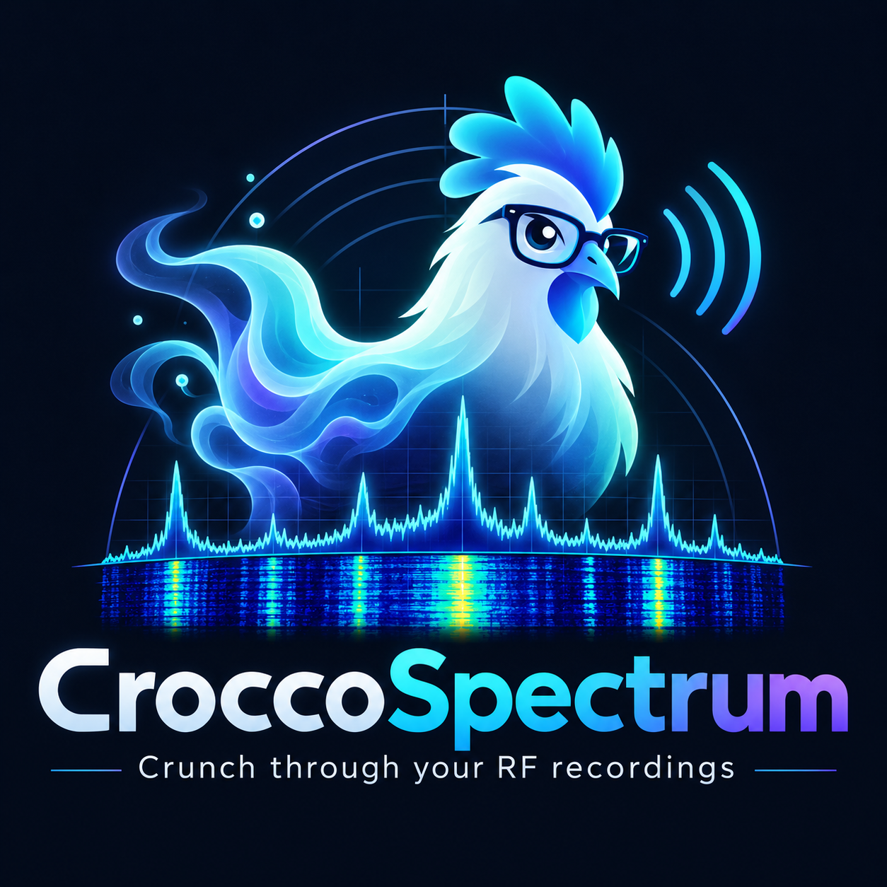
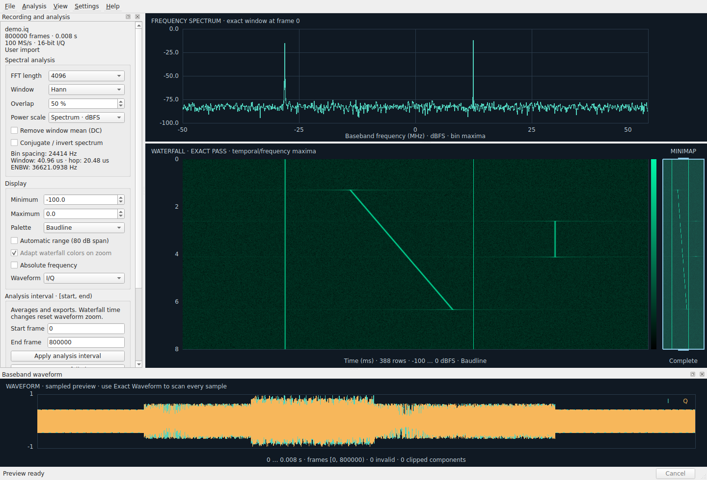

<p align="center">
  
</p>

<h1 align="center">CroccoSpectrum</h1>

<p align="center">
  <strong>Big recordings. Small details. Clear signals.</strong><br>
  Explore offline RF recordings with a native Linux spectrum analyzer.
</p>

<p align="center">
  <a href="https://github.com/gioeleminardi/CroccoSpectrum/actions/workflows/ci.yml"></a>
  <a href="https://github.com/gioeleminardi/CroccoSpectrum/releases/latest"></a>
  <a href="#build-from-source"></a>
  <a href="#build-from-source"></a>
  <a href="#linux-support"></a>
  <a href="LICENSE"></a>
</p>

<p align="center">
  <a href="https://gioeleminardi.github.io/CroccoSpectrum/#download"><strong>Download</strong></a> ·
  <a href="#quick-start">Quick start</a> ·
  <a href="#recording-formats">Formats</a> ·
  <a href="#command-line-tools">CLI</a> ·
  <a href="#build-from-source">Build</a> ·
  <a href="#documentation">Documentation</a>
</p>

---

**Turn a recording into a signal you can understand.** CroccoSpectrum brings
spectrum, waterfall, and waveform views together: find an event, zoom to its
samples, measure its frequency or duration, and export the result.

Real and complex I/Q recordings are read in bounded blocks, so file size does not
dictate how much RAM you need. FFTs, scans, and data exports run in cancellable
background jobs. Work with completed recordings or the downloaded portion of a
growing file, without RF hardware or an acquisition driver.



<p align="center">
  <em>A synthetic 100 MS/s I/Q recording, explored through dockable analysis panels.</em>
</p>

## What you can do

| | Capability | From recording to insight |
| --- | --- | --- |
| 📡 | **Explore the spectrum** | Linked spectrum and waterfall views, cursor readouts, frequency/time zoom, and a whole-recording minimap |
| 🔬 | **Choose your analysis** | FFTs from 256 to 1,048,576 points, four windows, overlap, DC removal, spectral inversion, and dBFS or PSD |
| 📊 | **Measure with exact passes** | Interval or whole-recording averages, max hold, exact waterfall overviews, and waveform min/max scans |
| 🌊 | **Inspect individual samples** | Independent waveform zoom down to one sample, connected I/Q traces, and shared hover/freeze controls |
| 🎨 | **Make the workspace yours** | Dockable panels, dark/light controls, saved layouts, and five palettes that recolor without rerunning FFTs |
| 💾 | **Keep and share your work** | Sessions, bookmarks, numeric CSV, plot PNG with metadata, and byte-exact recording excerpts |
| 🛠️ | **Automate offline analysis** | A headless CLI for inspection, spectra, averages, waveforms, and sample exports |

CroccoSpectrum is in early development. [Feature status](FEATURE_STATUS.md) lists
capabilities; [Validation](docs/VALIDATION.md) records the versions, environments,
and limits of the available test evidence.

## Quick start

### 1. Download and launch

Get a **stable release** or a **development build** from the
[download page](https://gioeleminardi.github.io/CroccoSpectrum/#download), or browse
[GitHub Releases](https://github.com/gioeleminardi/CroccoSpectrum/releases).
Development builds use `VERSION-dev.BUILD.gCOMMIT` and are intended for beta testing.

Packages include the GUI, CLI, application libraries, Qt plugins, and fonts.
The host supplies Linux, glibc, the display server, and graphics drivers. See
[Linux support](#linux-support) for the platform baseline.

Replace `VERSION` below with the version in your downloaded filename, including
any development suffix.

**AppImage**

```sh
chmod +x croccospectrum-VERSION-x86_64.AppImage
./croccospectrum-VERSION-x86_64.AppImage
```

On a system without FUSE, launch with `--appimage-extract-and-run`.

**Portable folder**

```sh
tar -xzf croccospectrum-VERSION-x86_64.tar.gz
./croccospectrum-VERSION-x86_64/AppRun
```

<details>
<summary><strong>CI artifacts and checksums</strong></summary>

Open [Actions](https://github.com/gioeleminardi/CroccoSpectrum/actions/workflows/ci.yml)
and select a successful run. Download `CroccoSpectrum-linux-amd64-AppImage` or
`CroccoSpectrum-linux-amd64-portable`, then extract its artifact ZIP. Each contains
one AppImage or portable tarball. Accompanying sources are in
`CroccoSpectrum-linux-amd64-sources`; checksums are in the `checksums/` directory
after extracting the `reports-release` artifact.

Place the matching `.sha256` beside the package and run:

```sh
sha256sum --check PACKAGE_FILENAME.sha256
```

Replace `PACKAGE_FILENAME` with the downloaded package's filename. Published
releases also carry source archives, checksums, and build information. See
[CI builds](docs/CI.md) for artifact contents and publication details.

</details>

### 2. Open a recording

Select **File → Open recording** and review the import preview. Set the sample
format, byte order, I/Q order, and sample rate to match the recording writer.
Open `.sigmf-meta` or `.rfmeta.json` metadata when available.

> **Raw files need an interpretation.** The initial preset is signed int16,
> complex I/Q, little-endian, at 100 MS/s. At this preset, 400 MB represents one
> second. A wrong format or rate changes what the plots mean.

### 3. Find an event and measure it

Navigate with the waterfall and minimap, then zoom into the event. Hover over the
waterfall or waveform to inspect a frame's spectrum; click to freeze or resume.
Use **Analysis** for exact averages, an exact waterfall overview, or **Exact
Waveform**. Save a session to return to the same interpretation and analysis.

The **Analysis interval** controls averages and sample exports. Waterfall
navigation changes the viewport independently; **Use waterfall view** applies its
bounds to the analysis interval. Waveform time follows waterfall navigation and
can then be zoomed independently, down to individual samples.

Press **F1** for keyboard shortcuts, or open **Help → Plot controls** for the
gesture guide. **View** shows or hides panels, including **Baseband waveform**.

## Recording formats

| Property | Supported values |
| --- | --- |
| Sample kind | One real stream or one complex I/Q stream |
| Component order | Interleaved IQ or QI |
| Integer encoding | Signed or unsigned 8, 16, packed 24, 32, and 64-bit |
| Floating-point encoding | IEEE FP16, FP32, and FP64 |
| Byte order | Little-endian and big-endian |
| Sample rate | Finite positive rates, including fractional values and scientific notation |
| Raw data layout | Explicit byte offset and optional data length |
| Metadata | Supported single-stream SigMF core subset and exported `.rfmeta.json` descriptors |

The DSP core uses double precision. Floating-point inputs have an explicit
full-scale reference; 64-bit integers are subject to double-precision analysis
limits. Required unsupported SigMF extensions, multiple streams, and later
embedded capture headers are rejected explicitly.

Optional capture timestamps and center frequencies provide UTC and absolute
frequency readouts. Sample indices remain the exact time reference; UTC aids are
labeled at millisecond resolution. Aggregates spanning retunes or unknown center
frequencies use baseband axes.

<details>
<summary><strong>Analyze a recording while it is still downloading</strong></summary>

Enable **Open partial / growing file** in the import dialog, or pass `--partial`
to the CLI. This opens a fixed snapshot of the complete sample frames available
at import, ignores an incomplete final frame, and clips declared data lengths,
captures, and annotations to that snapshot. At least one complete frame must
exist, and metadata JSON must already be complete.

The transfer may append bytes and update timestamps. The downloaded prefix must
remain unchanged: this mode does not detect edits within that prefix or missing
regions in preallocated files. Truncation below the opening file size or path
replacement stops reads. Reopen the original file to include newly downloaded
samples; sessions retain their snapshot bounds. Ordinary imports use strict
file-change and frame validation.

</details>

## From preview to exact analysis

Fast navigation and complete measurement passes have different coverage:

| View or operation | What it covers |
| --- | --- |
| **Spectrum** | The exact displayed FFT window; initially the first complete window in the analysis interval |
| **Waterfall viewport** | Bounded FFT work at display resolution; explicitly labeled when sampled |
| **Waterfall minimap** | Every required whole-recording window, reduced to temporal/frequency maxima in the background |
| **Spectral average / max hold** | Every eligible complete window in the selected interval or entire recording; the average uses linear power |
| **Exact waterfall overview + average** | A complete pass producing bounded maxima and an exact numeric average |
| **Waveform preview** | Up to 131,072 frames distributed across its visible interval |
| **Exact Waveform** | Every sample in the visible waveform interval, preserving min/max extrema |

Sampled previews can miss short events or isolated peaks. Use the minimap to
locate events, narrow the viewport for detail, and run exact analysis for
measurements. Invalid samples, capture-boundary windows, and incomplete trailing
windows are counted. Obsolete work is cancelled; incomplete averages are discarded
and older requests cannot replace newer results.

<details>
<summary><strong>FFT resolution and display controls</strong></summary>

FFT lengths are powers of two from **256 to 1,048,576**; the default is **4,096**.
Windows are Hann, rectangular, Hamming, and Blackman–Harris. At 100 MS/s:

| FFT length | Bin spacing | Window duration |
| --- | --- | --- |
| 4,096 | 24.414 kHz | 40.96 µs |
| 65,536 | 1.526 kHz | 655.36 µs |
| 1,048,576 | 95.367 Hz | 10.486 ms |

Bin spacing is distinct from window-adjusted resolution bandwidth. Longer FFTs
provide finer bins and cover longer time intervals.

**Settings → Waterfall rows** selects automatic display resolution or 128–4,096
rows. Higher densities can take longer and remain subject to memory and available
window limits. The initial 128-row preview is refined asynchronously; navigation
does not restart the whole-recording minimap scan. New recordings and DSP settings
do. Unprocessed minimap rows are blue-gray; invalid completed rows are magenta.

Viridis, Inferno, Grayscale, Turbo, and Baudline palettes recolor cached data
without rerunning FFTs. Baudline runs from black to `#00F9AB`. With **Automatic
range** enabled, **Adapt waterfall colors on zoom** can follow the displayed data
or keep the current limits fixed. Editing Minimum or Maximum disables Automatic
range and applies manual limits immediately.

</details>

<details>
<summary><strong>Navigation and measurement reference</strong></summary>

| Action | Control |
| --- | --- |
| Zoom frequency | Wheel over the spectrum; `Ctrl` + wheel over the waterfall |
| Pan frequency | Drag the spectrum or waterfall |
| Zoom / pan waterfall time | Wheel / drag inside the waterfall |
| Pan only waterfall time | `Ctrl` + left-button drag |
| Zoom / pan waveform time independently | Wheel / left-button drag inside the waveform |
| Move / resize the waterfall viewport | Drag the minimap box / its top or bottom handle |
| Inspect a frame's spectrum | Hover over the waterfall or waveform |
| Freeze / resume the shared frame | Click inside either time plot |
| Seek to a sample / exact time | Double-click a time plot / **View → Seek to time…** |
| Select an exact analysis interval | Enter 64-bit `[start, end)` frame bounds and apply |
| Measure spectrum width and integrated power | `Shift` + left-click the start, then left-click the end |
| Measure waterfall duration | `Shift` + left-click the start row, then left-click the end row |
| Move / resize a measurement | `Shift` + drag its band / boundary marker |
| Clear a measurement | `Escape` in that plot |
| Show the whole recording / reset frequency zoom | `Home` / `Ctrl+0` |
| Zoom / pan time | `Ctrl++` or `Ctrl+-` / `Alt+Left` or `Alt+Right` |
| Add a bookmark or note | `Ctrl+B` |

Spectrum endpoints snap to FFT bins and include both endpoints. Integrated band
power is reported in **dBFS**, using `sum(PSD × bin spacing)` or the equivalent
`sum(spectrum power × bin spacing / ENBW)`. The bandwidth is the included bin
count times the bin spacing, so a single-bin selection still has nonzero
bandwidth. Include the tone's window main lobe/leakage when measuring its power.
Frequency labels round to the nearest Hz, retaining compact kHz/MHz/GHz units.
Time readouts use s, ms, µs or ns according to magnitude. Numeric exports retain
the full frequency precision used by analysis. UI dB, dBFS and dBFS/Hz values use
one decimal place; power/SNR calculations and numeric exports retain full precision.
Waterfall duration uses the exact difference between row-start frames. Sampled
and aggregated rows limit event-boundary resolution.

Right-click a completed spectrum selection and choose **Use selection as signal
band** or **Use selection as noise band**. Assign two separate bands on the same
single-frame spectrum or completed interval average. Assignments copy the bounds;
reassign after editing them. Noise is normalized to the signal bandwidth:
`N = Pnoise × Bsignal / Bnoise`; **SNR** is
`10 log10(max(Psignal_band − N, 0) / N)`. This assumes representative additive
noise density; choose a noise-only band away from tones, leakage, DC and Nyquist.
Overlapping bands report SNR unavailable. Nonpositive net signal reports −∞ dB;
zero measured noise with positive signal reports +∞ dB. Both zero is unavailable.
Interval SNR uses the average trace; max-hold bins can come from different times.
**Clear signal and noise bands** keeps the ordinary selection; Escape clears all
bands. See [the numerical contract](docs/ARCHITECTURE.md#units-and-numerical-contract).

Waterfall markers fill draft Start/End fields without applying the interval.
The later row's start is the exclusive end. **Average waterfall selection**
averages the completed marked interval while keeping the current views; it needs
at least one FFT window and uses the markers even if the fields are later edited.

Measurements survive view, palette, and density changes, and clear when the
recording, analysis interval, or DSP settings change. They are transient and are
not saved in sessions. Changing waterfall time bounds resets waveform zoom;
frequency-only navigation retains independent waveform zoom and exact scans.

</details>

## Measurements and exports

Spectrum power uses **dBFS**; power spectral density uses **dBFS/Hz**. The reference
is one normalized mean-square unit: a unit complex tone is 0 dBFS, and a real
sine with peak amplitude 1 is −3.0103 dBFS. These are not calibrated dBm readings.

| Output | Contents |
| --- | --- |
| **CSV** | Numeric spectrum or average/max-hold bins, band power/SNR, settings, and coverage metadata |
| **PNG** | Plot snapshot with embedded recording and analysis metadata |
| **Raw sample range** | Original sample bytes plus a `.rfmeta.json` sidecar |
| **Session** | Recording interpretation, DSP/view settings, source identity, selection, and bookmarks |

Recordings are opened read-only. Exports refuse existing output paths, and
cancelled writes are not published as completed outputs. Application JSON stores
sample indices as decimal strings to preserve 64-bit values. Spectrum CSV and PNG
use the displayed FFT window; average exports use the completed analyzed interval.
Band metadata includes baseband bounds in Hz, bandwidth, dBFS power, SNR/noise
normalization, ENBW and status; bin columns keep their spectrum/PSD units. JSON
represents infinite logarithmic results as `"-inf"`/`"inf"`. Waterfall PNG metadata
records viewport bounds.

<details>
<summary><strong>Sample normalization and spectral conventions</strong></summary>

- Complex samples mean `I + jQ`; conjugation reverses frequency sign.
- Real input uses one-sided spectra: interior-bin power is doubled, DC and
  Nyquist are unchanged. Complex spectra are FFT-shifted.
- Signed integers are normalized by `2^(bits−1)`; unsigned integers are centered
  around their midpoint. Floating samples use a configurable full scale of 1 by default.
- Spectral averages use linear power; conversion to dB happens afterward.
- [Architecture](docs/ARCHITECTURE.md#units-and-numerical-contract) defines window
  normalization, equivalent noise bandwidth, and numerical edge cases.

</details>

## Command-line tools

The portable folder includes `croccospectrum-cli`. The examples below use a
[source build](#build-from-source); adjust the executable path for a package.

```sh
# Inspect metadata and decoded samples; add --partial for a growing download.
./build/release/croccospectrum-cli inspect --file capture.iq

# Make the raw interpretation explicit: signed int16 IQ, little-endian, 100 MS/s.
./build/release/croccospectrum-cli spectrum --file capture.iq \
  --kind complex --encoding signed --bits 16 --endian little --order IQ \
  --sample-rate 100000000 --fft 65536 --scale density

# Average the first 100 million frames, without printing every bin.
./build/release/croccospectrum-cli average --file capture.iq \
  --start 0 --end 100000000 --summary

# Inspect the exact waveform over a sample interval.
./build/release/croccospectrum-cli waveform --file capture.iq --start 1000 --end 5000

# Export original bytes in [1000, 5000), plus their metadata sidecar.
./build/release/croccospectrum-cli export-samples --file capture.iq \
  --start 1000 --end 5000 --output excerpt.iq
```

Run `--help` for all format, rate, window, overlap, and output options. Commands
emit JSON; spectrum and average also support CSV through `--output`. Add
`--band lower:upper`, `--signal-band lower:upper` and `--noise-band lower:upper`
to `spectrum` or `average` for integrated power/SNR. Bounds are inclusive baseband
Hz, must lie within the FFT bin-center domain, and must include at least one bin.
For example, `--signal-band 10000:20000 --noise-band 30000:50000` uses different
signal/noise bandwidths with the normalization above. Raw files
use the initial import preset unless flags specify another layout. Metadata
inputs use their saved interpretation; raw-format flags apply to raw binaries.

## Build from source

Use a **C++20 compiler**, **CMake 3.22+**, Ninja, pkg-config, **Qt 6.4+** development
files (Core, Gui, Widgets, Network, and Test), and **FFTW 3** double precision.
Python with NumPy/SciPy enables independent numerical checks; Node.js enables
website release-selection tests. Neither is an application runtime dependency.

<details>
<summary><strong>Ubuntu development dependencies</strong></summary>

```sh
sudo apt install build-essential cmake ninja-build pkg-config \
  qt6-base-dev qt6-wayland libfftw3-dev python3-numpy python3-scipy nodejs
```

</details>

<details>
<summary><strong>Fedora development dependencies</strong></summary>

```sh
sudo dnf install gcc-c++ cmake ninja-build pkgconf-pkg-config \
  qt6-qtbase-devel qt6-qtwayland fftw-devel python3-numpy python3-scipy nodejs
```

</details>

From the repository root:

```sh
cmake --preset release -DPython3_EXECUTABLE=/usr/bin/python3
cmake --build --preset release --parallel 2
ctest --preset release
./build/release/croccospectrum
```

For development, substitute the `debug` preset and launch from `build/debug/`.
Separate `asan` and `tsan` configure/build presets support sanitizer work; see
[Testing](docs/TESTING.md) for their runtime requirements and TSAN commands.
The independent reference suite skips when NumPy/SciPy are missing; a skipped
oracle does not establish numerical correctness.

`CMakeLists.txt` defines the planned release version. Source builds default to a
development identity with the commit ID and `.dirty` for modified checkouts.
`BUILD-INFO.json` in the build directory records the generated identity; release
optimization and a stable release channel are separate choices.

<details>
<summary><strong>Build portable packages with the baseline container</strong></summary>

With Docker installed, run the same release pipeline used by CI:

```sh
bash ci/build.sh release
```

For Podman, use `RF_CI_ENGINE=podman bash ci/build.sh release`. The pipeline needs
network access to obtain its pinned tools, Qt SDK, and dependency sources. It
builds against Ubuntu 22.04, runs tests, checks the bundled ELF glibc requirements,
and checks the final packages in offline Ubuntu 22.04/24.04/26.04 and Fedora 44
containers.

Packages appear in `dist/ci/release/packages/`, sources in `sources/`, and reports
and checksums in `reports/` beneath `dist/ci/release/`. Dependency pins live in
[packaging/dependencies.json](packaging/dependencies.json). See [CI builds](docs/CI.md)
for configuration and [Third-party components](docs/THIRD_PARTY.md) for notices
and accompanying source provisions.

</details>

## Linux support

Portable builds target **Linux x86_64 with glibc 2.35+**, using X11 or Wayland.
They use an Ubuntu 22.04 baseline and bundle Qt 6.11.2. Recorded package checks
cover offline portable-folder and AppImage launches on Ubuntu 22.04, Ubuntu 24.04,
Ubuntu 26.04 and Fedora 44, plus Ubuntu 22.04 headless X11 startup at normal and
doubled scale.

Published packages through v0.5.0 use the Ubuntu 24.04/glibc 2.39 baseline.

On Ubuntu 24.04 Wayland sessions, the GUI prefers XWayland when an X11 display is
available to support panel dragging and docking. Explicit `QT_QPA_PLATFORM` or
`-platform` overrides take precedence; use `QT_QPA_PLATFORM=wayland` to select
native Wayland there. Other systems retain Qt's default backend selection.

These checks do not cover every desktop, high-DPI, or multiple-monitor setup.
See [Validation](docs/VALIDATION.md) for the qualification scope.

<details>
<summary><strong>Update checks and network behavior</strong></summary>

Normal GUI launches check GitHub for stable releases five seconds after startup
and every 24 hours while running. A version is offered only when both Linux
packages and their checksums are present, once per app session. The notification
opens the project website for manual download and installation.

Use **Help → Automatically check for updates** to disable background checks, or
**Help → Check for updates…** for a manual check. Automatic failures stay quiet;
manual checks report errors and rate limits. Requests respect retry limits and
do not include recordings or sessions. The CLI, routine tests, screenshots, and
smoke launches do not perform update requests.

</details>

## Performance

Bounded reads and caches keep navigation independent of whole-file loading.
Large FFT scans use bounded parallel workers and preserve ordered reductions;
short jobs and memory-heavy FFTs use fewer workers.

Current Release measurements on a Ryzen 9 9950X3D with NVMe storage
(2026-10-14; medians of three runs):

| Workload | Measured result |
| --- | --- |
| Initial GUI preview of a 40 GB file | 156 ms, including a 100 ms layout delay |
| Full average of 400 MB / 4 GB, FFT 4,096 | 0.309 s / 2.865 s; about 1.3–1.4 GB/s |
| Full average of 400 MB / 4 GB, FFT 65,536 | 0.444 s / 4.299 s; about 0.9 GB/s |
| Peak process RSS for these threaded averages | About 110–122 MiB |

The average passes use automatic parallel workers, warm-cache synthetic int16
I/Q at 100 MS/s, Hann windows, and 50% overlap. Observed 4 GB timings span
2.066–2.969 s at FFT 4,096 and 4.228–5.062 s at FFT 65,536. The GUI preview is
offscreen. [Benchmarks](docs/BENCHMARKS.md) records settings, CPU use, memory,
timing ranges, and measurement scope; these figures are not performance guarantees.

## Contributing

Start with [AGENTS.md](AGENTS.md) for repository context, coding conventions,
numerical and threading rules, and checks matched to the change. Keep patches
focused and verify behavior with the relevant core, UI, or independent reference
tests. Changes to user-visible behavior should also update the relevant docs and
the changelog's **Unreleased** section.

Report bugs or suggest improvements through
[GitHub Issues](https://github.com/gioeleminardi/CroccoSpectrum/issues). Include the
build version, OS/Qt environment, recording interpretation, steps to reproduce,
and expected versus observed behavior. A small synthetic fixture is useful for
reproducing a signal-processing issue.

## Documentation

| Guide | What you will find |
| --- | --- |
| [Agent and contributor guide](AGENTS.md) | Current architecture, working practices, invariants, and verification commands |
| [Architecture](docs/ARCHITECTURE.md) | Recording access, DSP conventions, ownership, scheduling, and resource bounds |
| [Feature status](FEATURE_STATUS.md) | Capability inventory and supported formats |
| [Testing](docs/TESTING.md) | Numerical checks, sanitizers, benchmarks, and sustained-use tests |
| [Validation](docs/VALIDATION.md) | Recorded evidence, tested environments, and coverage limitations |
| [CI builds](docs/CI.md) | Artifacts, packaging, build identities, and release publication |
| [Benchmarks](docs/BENCHMARKS.md) | Performance measurements and reference hardware |
| [Changelog](CHANGELOG.md) | Release history and behavior changes |
| [Third-party components](docs/THIRD_PARTY.md) | Dependency licenses, notices, and source provisions |

## License

CroccoSpectrum is licensed under **GPL-3.0-or-later**. See [LICENSE](LICENSE).
Bundled components retain their respective licenses and notices, documented in
[Third-party components](docs/THIRD_PARTY.md).
